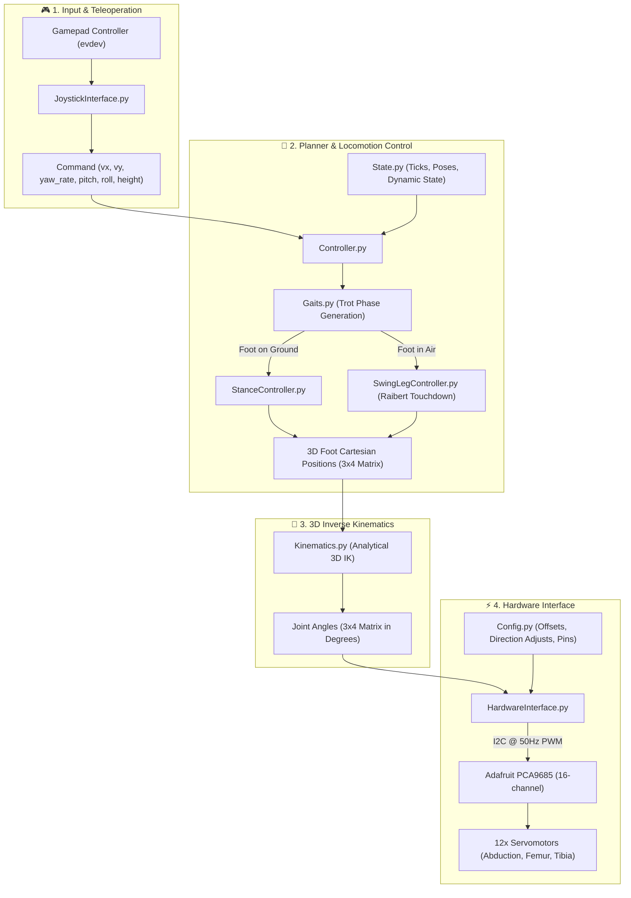

# 🐾 Robot-Dog-Maua — Autonomous Quadruped Robot

[](https://www.python.org/downloads/)
[](https://www.raspberrypi.com/)
[](LICENSE)

A 12-degree-of-freedom (12-DOF) quadruped robot developed at **Instituto Mauá de Tecnologia (IMT)**. The system is powered by a **Raspberry Pi 4**, featuring decoupled locomotion control (*Stance* and *Swing* controllers with a *Raibert Touchdown* heuristic), 3D analytical inverse kinematics, an I2C bus with an Adafruit **PCA9685** 16-channel PWM driver for 12 servomotors, and low-latency teleoperation via Bluetooth/USB gamepads using Linux **evdev**.

---

## 🏗️ System Architecture



---

## 🛠️ Hardware Specifications

| Component | Model / Specification | Connection Details |
|---|---|---|
| **Onboard Computer** | Raspberry Pi 4 Model B (2GB+) | Executes the main real-time control loop at 100 Hz (`dt = 0.01s`) |
| **PWM / Servo Driver** | Adafruit PCA9685 (16 channels, 12-bit) | I2C1 bus (SDA: Pin 3, SCL: Pin 5) |
| **Actuators (12x)** | High-torque standard servomotors (20–35 kg·cm) | 3 per leg: Abduction (Hip Roll), Femur, Tibia |
| **IMU (Optional)** | MPU6050 (GY-521) 6-DOF IMU | I2C1 bus (Address `0x68`) with integrated Kalman filter |
| **Gamepad / Controller** | GameSir T4 / Xbox / PS3 compatible | Low-level event reading via `/dev/input/event*` (`evdev`) |
| **Logic Power Supply** | Official Raspberry Pi USB-C power supply (5V / 3A) | Dedicated logic power to prevent noise-induced brownouts |
| **Motor Power Supply** | Regulated DC bench supply or 2S LiPo with high-amp BEC (5V–6V) | **Minimum 6A to 10A peak** (servos under dynamic load) |

> ⚠️ **Electrical Warning:** Never power the 12 servomotors directly from the 5V pins of the Raspberry Pi. Always use the external screw terminal block (green connector) on the PCA9685 board with a dedicated high-current supply and share a common ground (GND).

---

## 🔌 Pinout & Wiring

### I2C Bus (Raspberry Pi 4 ↔ PCA9685 & MPU6050)

| Raspberry Pi 4 | PCA9685 | MPU6050 (GY-521) | Function |
|---|---|---|---|
| **Pin 1 (3V3)** | VCC (Logic) | VCC | 3.3V Logic power |
| **Pin 3 (SDA)** | SDA | SDA | I2C Data line |
| **Pin 5 (SCL)** | SCL | SCL | I2C Clock line |
| **Pin 6, 9, or 14 (GND)** | GND | GND | Common ground reference |

### Servo Motor Power Supply
* **Green Terminal Block on PCA9685 (V+):** Positive terminal of external DC supply (+5V to +6V).
* **Green Terminal Block on PCA9685 (GND):** Negative terminal of external supply (tied to Raspberry Pi GND).

### PCA9685 Servo Channels Mapping

| Leg | Description | Abduction Channel | Femur Channel | Tibia Channel |
|---|---|:---:|:---:|:---:|
| **FR** | Front Right | Channel 1 | Channel 2 | Channel 0 |
| **FL** | Front Left | Channel 6 | Channel 7 | Channel 5 |
| **RR** | Rear Right | Channel 14 | Channel 13 | Channel 15 |
| **RL** | Rear Left | Channel 9 | Channel 8 | Channel 10 |

---

## ⚠️ Bench Safety Protocol

Quadruped robots equipped with high-torque metal-gear servomotors can strip gears or draw destructive currents if driven past mechanical limits:

1. **Suspended Bench Testing:** During initial bringup or after modifying offsets in `Config.py`, place the robot chassis on an elevated stand so that **all 4 legs are free in the air**.
2. **Power-Up Sequence:**
   - 1st: Power the Raspberry Pi logic and wait for the OS to complete booting.
   - 2nd: Turn on/connect the gamepad controller.
   - 3rd: Turn on the external high-current power supply for the servos.
3. **Deactivation and Emergency Power-Off:** `L1` transitions the robot to its nominal standing pose over approximately 1.2 seconds, then returns to idle; the servos remain energized. `Ctrl + C` exits the program but does not disable PCA9685 PWM. Neither action removes servo holding torque. Use an external servo-power cutoff for an emergency stop.

---

## 🚀 Quick Start

### 1. Clone & Set Up Python Virtual Environment (on the Raspberry Pi)

```bash
# Clone the repository
git clone https://github.com/Maua-Robotics/Robot-Dog-Maua.git
cd Robot-Dog-Maua

# Create and activate virtual environment
python3 -m venv env
source env/bin/activate

# Install required dependencies
pip install -r requirements.txt
```

### 2. Manual Execution

Accessing `/dev/i2c-1` and raw input events from `/dev/input/event*` requires superuser privileges:

```bash
# Run explicitly using the virtual environment interpreter
sudo env/bin/python3 main/main.py
```

> 💡 **Note on `sudo` with virtual environments:** Never run `sudo python3 main/main.py`, as that invokes the global system Python instead of your virtual environment. Always specify the relative venv path `sudo env/bin/python3`.

### 3. Gamepad Button Layout

| Button | Function on Robot |
|---|---|
| **L1** | Activate / Deactivate (toggles between `DEACTIVATED` and `REST`) |
| **R1** | Start / Stop Trot Locomotion (`TROT`) |
| **A** | Smooth transition between laying down and standing up (`Lay` / `Stand`) |
| **X** | Mechanical calibration pose (all servos commanded to 90° neutral) |
| **Left Joystick (LX, LY)** | Translational velocity ($V_x$ forward/back, $V_y$ lateral) |
| **Right Joystick (RX, RY)** | Yaw angular velocity ($R_x$) and Pitch tilt ($R_y$) |
| **D-Pad (Directional Pad)** | Continuous fine-tuning of body Height ($Z$) and Roll ($X$) |

---

## ⚙️ Headless Operation & Autostart (Systemd)

The robot can operate autonomously in the field without requiring a monitor, keyboard, or SSH connection, starting automatically when the Raspberry Pi boots.

### Installing the Systemd Service

From the root of the project, execute:

```bash
sudo bash main/systemd/install_service.sh
```

The installer generates `/etc/systemd/system/robot-dog.service` configured with the project's virtual environment and enables it at boot.

### Service Management Commands

```bash
systemctl status robot-dog          # Check service status and health
journalctl -u robot-dog -f          # Stream live logs in real time
sudo systemctl restart robot-dog    # Restart service
sudo systemctl stop robot-dog       # Stop service (required before manual execution)
sudo systemctl disable robot-dog    # Disable automatic start on boot
```

---

## 📁 Repository Structure

```
Robot-Dog-Maua/
├── docs/                           # In-depth technical engineering documentation
│   ├── 01_architecture_and_state_machine.md  # Real-time control loop & state machine
│   ├── 02_kinematics_and_gait.md             # 3D analytical IK & Raibert touchdown model
│   ├── 03_hardware_and_wiring.md             # Detailed pinout, I2C bus & power schematics
│   ├── 04_calibration_guide.md               # Calibration manual & software offset calculation
│   ├── 05_gamepad_setup.md                   # Gamepad configuration & evdev troubleshooting
│   └── 06_systemd_autostart.md               # Headless daemon configuration & log analysis
├── main/                           # Active software pipeline
│   ├── main.py                     # Real-time execution loop (100 Hz) & state dispatch
│   ├── Config.py                   # Geometric dimensions, pin mapping, limits, and poses
│   ├── State.py                    # Telemetry data structures & dynamic state
│   ├── Command.py                  # Consolidated user command vector
│   ├── Controller.py               # Gait manager & behavior state transitions
│   ├── Gaits.py                    # Trot gait phase generator & timing logic
│   ├── StanceController.py         # Stance leg trajectory planner
│   ├── SwingLegController.py       # Swing leg trajectory planner (Raibert touchdown)
│   ├── Kinematics.py               # 3D analytical inverse kinematics (3x4 matrix format)
│   ├── Transformations.py          # 3D rotation math (Euler angles & Quaternions)
│   ├── HardwareInterface.py        # PCA9685 driver interface & quintic Hermite smoothing
│   ├── JoystickInterface.py        # Asynchronous gamepad reader via Linux evdev
│   ├── IMU.py                      # MPU-6050 6-DOF IMU driver with 2-state Kalman filter
│   └── systemd/                    # Service installation script and unit template
├── Testes Interface/               # Diagnostic and bench testing tools
│   ├── controle_servos.py          # Manual channel-by-channel PCA9685 servo tester
│   ├── mapear_controle.py          # Real-time event and keycode mapper for any gamepad
│   └── teste_servos.py             # Angular sweep integrity verification script
├── legacy_main/                    # Historical/archived previous version (for reference)
├── DOCUMENTATION_PLAN.md           # Engineering master roadmap and specification plan
├── CONTRIBUTING.md                 # Contribution guidelines, coding standards & safety rules
├── requirements.txt                # Python package dependencies
└── README.md                       # Project entry point & overview
```

---

## 📖 In-Depth Technical Documentation

Explore the comprehensive mathematical models, hardware diagrams, and calibration manuals in [`docs/`](docs/):

| Document | Description |
|---|---|
| **[Architecture & States](docs/01_architecture_and_state_machine.md)** | 100 Hz deterministic loop, behavioral state transitions, and the $3 \times 4$ matrix convention. |
| **[Kinematics & Gait](docs/02_kinematics_and_gait.md)** | Step-by-step 3D analytical IK derivation, link lengths, lateral abduction, and Raibert Touchdown trotting. |
| **[Hardware & Wiring](docs/03_hardware_and_wiring.md)** | Full PCA9685 channel table, I2C schematics, logic/motor power isolation, and current requirements. |
| **[Calibration Guide](docs/04_calibration_guide.md)** | Mechanical 90° zero alignment and practical offset calculation in `Config.py`. |
| **[Gamepad Setup](docs/05_gamepad_setup.md)** | Linux `evdev` subsystem configuration, Bluetooth pairing, deadband filtering, and adding new controllers. |
| **[Autostart on Boot (Systemd)](docs/06_systemd_autostart.md)** | Headless deployment, systemd unit templates, restart loops, and log inspection. |

---

## 👥 Authors & Contributions

Developed by the robotics research team at **Instituto Mauá de Tecnologia (IMT)**. For contribution guidelines, style standards, and safety verification procedures, please consult [CONTRIBUTING.md](CONTRIBUTING.md).
