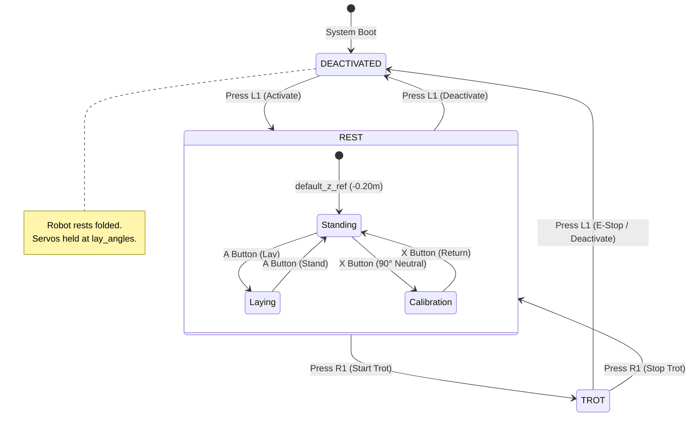

# 🧠 System Architecture & Behavioral State Machine

> **Module:** `main/`  
> **Control Frequency:** $100\text{ Hz}$ ($\Delta t = 0.01\text{ s}$)  
> **Matrix Standard:** $\mathbb{R}^{3 \times 4}$ (3 joints $\times$ 4 legs)

---

## 1. Control Pipeline Overview

The software architecture of **Robot-Dog-Maua** is structured around a decoupled modular design inspired by modern quadruped research platforms (such as the MIT Cheetah and Stanford Pupper lineages). The pipeline enforces strict separation of concerns across five layers:

1. **Input Layer (Teleoperation):** Asynchronous capture of gamepad events (`JoystickInterface`) translated into a consolidated intention vector (`Command`).
2. **Planning & State Layer (`Controller`):** Orchestrates high-level behavioral transitions and advances the gait timing machine.
3. **Dynamic Locomotion Layer:**
   - **`StanceController`:** Computes ground contact foot trajectories to propel the body in the desired translational and yaw directions.
   - **`SwingLegController`:** Computes 3D parabolic aerial trajectories for feet repositioning forward in the air (*Raibert Touchdown* heuristic).
4. **Inverse Kinematics Layer (`Kinematics`):** Analytically transforms 3D Cartesian foot target coordinates $[x, y, z]^T$ into joint servo angles $[\theta_{\text{abduction}}, \theta_{\text{femur}}, \theta_{\text{tibia}}]^T$.
5. **Hardware Actuation Layer (`HardwareInterface`):** Applies mechanical zero offsets, joint orientation mirrors, and writes to PCA9685 PWM registers via I2C with quintic Hermite smootherstep interpolation.

---

## 2. Behavioral Finite State Machine

The robot's behavioral state is governed by the `BehaviorState` enumeration defined in [`main/State.py`](../main/State.py):



### State Breakdown:

| State | Physical Behavior & Description |
|---|---|
| **`DEACTIVATED`** | Safe initial state after booting. Servomotors are positioned in the folded rest pose (`lay_angles`). Locomotion and velocity commands are ignored. |
| **`REST`** | Active standing support. All four feet maintain firm ground contact at the nominal standing height (`default_z_ref = -0.20m`). The operator can tilt the chassis in *Roll* and *Pitch*, adjust height ($Z$), or trigger static poses (Lay/Stand toggle via button `A` and 90° Calibration pose via button `X`). |
| **`TROT`** | Dynamic trotting locomotion. The robot coordinates diagonal leg pairs (Diagonal A: FR + RL / Diagonal B: FL + RR), alternating between support (*stance*) and aerial swing (*swing*) phases to achieve omnidirectional planar velocity ($V_x, V_y$) and yaw rate ($\omega_z$). |

---

## 3. The Fundamental Matrix Convention ($3 \times 4$)

All mathematical transformations, foot position matrices, joint angle arrays, and calibration buffers adhere strictly to 2D NumPy arrays of shape `(3, 4)`. Maintaining this convention is vital to prevent accidental joint or leg swaps:

### Matrix Layout Definition:

$$\mathbf{M} = \begin{bmatrix}
m_{0,0} & m_{0,1} & m_{0,2} & m_{0,3} \\
m_{1,0} & m_{1,1} & m_{1,2} & m_{1,3} \\
m_{2,0} & m_{2,1} & m_{2,2} & m_{2,3}
\end{bmatrix}$$

* **Rows (Joints / Cartesian Spatial Axes):**
  - **Row 0:** Abduction/Hip Roll Joint (Rotation about $X$ in the $YZ$ plane) or Foot Cartesian $X$-coordinate.
  - **Row 1:** Femur Joint (Rotation about $Y$ in the $XZ$ plane) or Foot Cartesian $Y$-coordinate.
  - **Row 2:** Tibia/Knee Joint (Rotation about $Y$ in the $XZ$ plane) or Foot Cartesian $Z$-coordinate.

* **Columns (Leg Indices):**
  - **Column 0:** **FR** (*Front Right*)
  - **Column 1:** **FL** (*Front Left*)
  - **Column 2:** **RR** (*Rear Right*)
  - **Column 3:** **RL** (*Rear Left*)

---

## 4. Coordinate System & Physical Conventions

The robot follows the standard right-handed Cartesian coordinate convention for mobile robotics:

```
               +Z (Up)
                 ▲
                 │
                 │   +X (Forward)
                 │  ▲
                 │ /
                 │/
   -Y (Right) ───┼─────► +Y (Left)
                /│
               / │
              /  │
                 ▼
               -Z (Feet on Ground: Z < 0)
```

* **Origin $[0, 0, 0]$:** Geometric center of the robot chassis.
* **$+X$-Axis:** Points directly forward (heading direction).
* **$+Y$-Axis:** Points to the robot's left (right-hand rule).
* **$+Z$-Axis:** Points vertically upward (feet in ground contact always have **negative $Z$ values**, typically between $-0.18\text{ m}$ and $-0.22\text{ m}$).
* **Euler Attitude Angles:**
  - **Roll ($\phi$):** Rotation about the $X$-axis (lateral tilt).
  - **Pitch ($\theta$):** Rotation about the $Y$-axis (nose up/down).
  - **Yaw ($\psi$):** Rotation about the $Z$-axis (heading direction).

---

## 5. Real-Time Deterministic Control Loop (`main.py`)

The main execution script [`main/main.py`](../main/main.py) implements a fixed-rate synchronous loop:

```python
# Rate defined in Config.py: config.dt = 0.01 (100 Hz)
now = time.time()
if now - last_loop < config.dt:
    continue
last_loop = time.time()

# 1. Non-blocking polling of gamepad events
command = joystick.get_command(state)

# 2. Read inertial orientation (if IMU enabled)
state.quat_orientation = imu.read_orientation() if use_imu else np.array([1, 0, 0, 0])

# 3. Advance controller state machine (Stance + Swing + Kinematics)
controller.run(state, command)

# 4. Dispatch computed angles to servomotors via PCA9685 I2C
hardware_interface.set_actuator_positions(state.joint_angles)
```

This architecture ensures that minor jitter in gamepad polling or I2C write cycles does not destabilize gait phase synchronization.
