# 📐 3D Inverse Kinematics & Gait Generation

> **Modules:** [`Kinematics.py`](../main/Kinematics.py), [`Gaits.py`](../main/Gaits.py), [`StanceController.py`](../main/StanceController.py), [`SwingLegController.py`](../main/SwingLegController.py)

---

## 1. Geometric Leg Model

Each of the robot's four legs consists of a **three-degree-of-freedom (3-DOF)** open kinematic chain driven directly by servomotors:

1. **Abduction/Adduction Joint ($\theta_1$):** Longitudinal axis ($X$). Controls lateral leg tilt and compensates for roll.
2. **Femur / Hip Pitch Joint ($\theta_2$):** Transverse axis ($Y$). Moves the upper leg forward and backward.
3. **Tibia / Knee Joint ($\theta_3$):** Transverse axis ($Y$). Articulates the lower leg for extension or flexion.

```
       [Shoulder Base on Chassis]
                   │
            (Abduction / X-Axis)
                   │ ◄── Abduction Offset (40 mm)
                   ▼
               [Shoulder]
                  /
                 /  L₁ = 130 mm (Femur / Upper Leg)
                /
               ▼
            [Knee]
              \
               \  L₂ = 120 mm (Tibia / Lower Leg)
                \
                 ▼
              [Foot (x, y, z)]
```

### Physical Link Dimensions (defined in `Config.py`):

| Parameter | Variable Name | Value | Description |
|---|---|---|---|
| Femur Length | `config.LEG_L1` | $0.130\text{ m}$ ($130\text{ mm}$) | Joint distance between shoulder and knee |
| Tibia Length | `config.LEG_L2` | $0.120\text{ m}$ ($120\text{ mm}$) | Joint distance between knee and foot tip |
| Abduction Offset | `config.ABDUCTION_OFFSET` | $0.040\text{ m}$ ($40\text{ mm}$) | Lateral offset between abduction axis and leg plane |
| Max Safe Reach | $B_{\max}$ | $0.245\text{ m}$ ($245\text{ mm}$) | Extension ceiling to avoid full-extension singularities |

---

## 2. 3D Inverse Kinematics Derivation (`Calculate_IK`)

The goal of Inverse Kinematics (IK) is to take a target foot position vector $\mathbf{P} = [x, y, z]^T$ relative to the leg base origin and compute the joint angle trio $[\theta_1, \theta_2, \theta_3]$.

### Step 1: Symmetry Mirroring (Right vs. Left Legs)
Because right and left legs are mechanically mirrored, right-side legs ($FR = 0, RR = 2$) have their lateral coordinate $y$ inverted:
$$y_{\text{calc}} = \begin{cases} -y, & \text{if right leg } (i \in \{0, 2\}) \\ y, & \text{if left leg } (i \in \{1, 3\}) \end{cases}$$

### Step 2: Abduction Angle ($\theta_1$) on the Frontal $YZ$ Plane
Projecting the foot position onto the frontal $YZ$ plane:
1. Projected distance in the plane:
   $$d_{yz} = \sqrt{y^2 + z^2}$$
2. Vector angle with the horizontal axis:
   $$\alpha_1 = \text{atan2}(z, y) \pmod{2\pi}$$
3. Internal angle from the right triangle with abduction offset $d_{\text{abd}}$:
   $$\alpha_2 = \arcsin\left(\text{clamp}\left(\frac{\sin(\phi) \cdot d_{\text{abd}}}{\max(d_{yz}, 10^{-9})}, -1.0, 1.0\right)\right)$$
   $$\alpha_3 = \pi - \alpha_2 - \phi \quad \left(\text{where } \phi = \frac{\pi}{2}\right)$$
4. Abduction joint angle:
   $$\theta_1 = (\alpha_1 + \alpha_3) \pmod{2\pi}$$

### Step 3: Transformation to the Rotated 2D Leg Plane ($X, Z'$)
With $\theta_1$ determined, the abduction offset is subtracted and the frame is rotated about the $X$-axis by the corresponding angle. The resulting vector in the leg plane has components $(x', z')$:
$$B = \sqrt{(x')^2 + (z')^2}$$

To prevent geometric singularities and motor stall, extension $B$ is clamped to the maximum reachable boundary:
$$B_{\text{safe}} = \min(B, 0.245\text{ m})$$

### Step 4: Solving Femur and Tibia Angles (Law of Cosines)
In the planar triangle formed by $L_1$, $L_2$, and $B_{\text{safe}}$:

1. **Line of Sight Angle:**
   $$b_1 = \text{atan2}(z', x') \pmod{2\pi}$$

2. **Law of Cosines for Femur Angle ($\beta_2$):**
   $$\cos(\beta_2) = \frac{L_2^2 + B^2 - L_1^2}{2 \cdot L_2 \cdot B} \implies \beta_2 = \arccos(\text{clamp}(\cos(\beta_2), -1.0, 1.0))$$

3. **Law of Cosines for Knee Angle ($\beta_3$):**
   $$\cos(\beta_3) = \frac{L_2^2 + L_1^2 - B^2}{2 \cdot L_2 \cdot L_1} \implies \beta_3 = \arccos(\text{clamp}(\cos(\beta_3), -1.0, 1.0))$$

4. **Primary Joint Angles:**
   $$\theta_2 = b_1 - \beta_2$$
   $$\theta_3 = \pi - \beta_3$$

### Step 5: Offset Phase Correction & Physical Safety Limits
Angles are converted from radians to degrees and passed through `apply_physical_limits`:
* $\theta_1$ (Abduction): clamped rigidly between $[60^\circ, 120^\circ]$.
* $\theta_2$ (Femur): clamped between $[25^\circ, 180^\circ]$.
* $\theta_3$ (Tibia): dynamically bounded as a function of femur position to prevent mechanical chassis collisions:
  $$\theta_{3,\min} = \max(42^\circ, \theta_2 - 109^\circ), \quad \theta_{3,\max} = \min(125^\circ, \theta_2 + 20^\circ)$$

---

## 3. Trot Gait Generation

Trotting is the most energy-efficient and dynamic gait for quadruped robots at moderate velocities. Legs are grouped into two alternating diagonal pairs:
* **Diagonal Pair A:** Front Right (**FR**) + Rear Left (**RL**)
* **Diagonal Pair B:** Front Left (**FL**) + Rear Right (**RR**)

```mermaid
gantt
    title Trot Gait Phase Cycle (1 Cycle = 2 * overlap + 2 * swing)
    dateFormat X
    axisFormat %s s
    section Diagonal A (FR, RL)
    Stance (Support) :active, 0, 10
    Swing (Flight)   :crit, 10, 25
    Stance (Support) :active, 25, 35
    Stance (Support) :active, 35, 50
    section Diagonal B (FL, RR)
    Stance (Support) :active, 0, 10
    Stance (Support) :active, 10, 25
    Stance (Support) :active, 25, 35
    Swing (Flight)   :crit, 35, 50
```



### Gait Timing Parameters:
- $\Delta t = 0.01\text{ s}$ ($100\text{ Hz}$)
- `overlap_time` $= 0.10\text{ s}$ ($10$ ticks): Quadruple-support phase ensuring smooth momentum transfer.
- `swing_time` $= 0.15\text{ s}$ ($15$ ticks): Aerial step duration for flight legs.
- **Total cycle duration:** $0.50\text{ s}$ ($50$ ticks).

---

## 4. Stance Controller (`StanceController`)

When a foot is in ground contact ($contact\_mode = 1$), it moves in the opposite direction of the desired body velocity to generate traction:

$$\mathbf{v}_{\text{foot}} = \begin{bmatrix} -V_x \\ -V_y \\ \frac{1}{\tau_z} (Z_{\text{target}} - Z_{\text{actual}}) \end{bmatrix}$$

When a yaw rate ($\omega_z$) is requested, an incremental planar rotation matrix is applied:
$$\mathbf{P}_{k+1} = \mathbf{R}_z(-\omega_z \cdot \Delta t) \cdot \mathbf{P}_k + \mathbf{v}_{\text{foot}} \cdot \Delta t$$

---

## 5. Swing Controller & Raibert Touchdown Heuristic (`SwingLegController`)

When a foot lifts off, the planner calculates **where the foot should land** to ensure dynamic stability at the commanded velocity.

We employ the classic **Raibert Touchdown formula (1986)**:
$$\Delta x_{\text{touchdown}} = \alpha \cdot T_{\text{stance}} \cdot V_x$$
$$\Delta y_{\text{touchdown}} = \alpha \cdot T_{\text{stance}} \cdot V_y$$

* $T_{\text{stance}}$: Total stance duration of the upcoming support phase.
* $\alpha \approx 0.5$: Empirical constant placing the foot precisely at the midpoint of the center-of-mass travel window.

### Foot Ground Clearance Profile:
The vertical foot elevation $z(t)$ during swing follows a smooth trajectory parameterized by `config.z_clearance` ($0.12\text{ m}$):
$$z_{\text{swing}}(s) = \begin{cases} 
\frac{s}{0.5} \cdot z_{\text{clearance}}, & s < 0.5 \\
z_{\text{clearance}} \cdot \left(1 - \frac{s - 0.5}{0.5}\right), & s \ge 0.5
\end{cases}$$
where $s \in [0, 1]$ represents the normalized swing phase progress.
